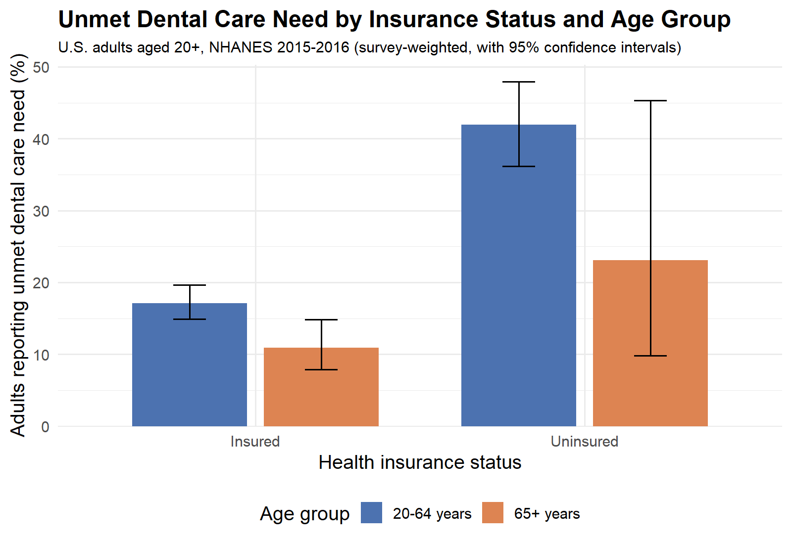

```{r setup, include=FALSE}
knitr::opts_chunk$set(echo = FALSE, message = FALSE, warning = FALSE)
library(knitr)

t1  <- readRDS("output/table1.rds")      
fd  <- readRDS("output/figure1_data.rds") 

p   <- t1$numeric
pct <- function(x) sprintf("%.1f", 100 * x)
all_row <- p[p$insurance == "All adults", ]
ins_row <- p[p$insurance == "Insured", ]
uni_row <- p[p$insurance == "Uninsured", ]
fig_pct <- function(ins, age) sprintf("%.1f", fd$prev[fd$insurance == ins & fd$age_group == age])
```

Introduction

Data set: This report uses the 2015-2016 cycle of the National Health and Nutrition
Examination Survey (NHANES), a nationally representative, cross-sectional survey of the
civilian, non-institutionalized U.S. population run by the National Center for Health
Statistics (NCHS) at the CDC. NHANES uses a complex, multistage sampling design, so all
estimates in this report use the survey weights, strata, and primary sampling units. Three
public-use files from the household interview are combined using the respondent ID
(`SEQN`): Demographics (`DEMO_I`), Health Insurance (`HIQ_I`), and Oral Health
Questionnaire (`OHQ_I`).

Research question: Among U.S. adults, is lack of health insurance associated with a
higher likelihood of self-reported unmet dental care need in the past 12 months?

Analysis objectives:

1. Estimate the survey-weighted prevalence of unmet dental care need, overall and by health
   insurance status, among adults aged 20 years and older.
2. Show how that prevalence differs by insurance status within two age groups (20-64 years
   and 65 years and older).

The analysis is limited to adults aged 20 and older because the education variable used in
later models is only collected for that age group. Insurance status refers to general health
insurance coverage, not dental-specific coverage.

## Preparing the Variables

The three files are merged on `SEQN` (code in `code/01_clean_data.R`). "Refused" and
"Don't know" answers are treated as missing, and race/ethnicity, education, and income are
collapsed to four categories or fewer. The survey design is built on the full data first;
the analytic sample (adults 20 and older with complete information on every variable) is
then selected within the design, which keeps the NHANES sampling structure intact.

Table: Unmet Dental Care Need by Insurance Status

```{r table1}
kable(t1$table, align = c("l", "r", "r", "r"),
      format.args = list(big.mark = ","),
      caption = "Table 1. Survey-weighted prevalence of unmet dental care need in the past 12 months among U.S. adults aged 20 and older, by health insurance status (NHANES 2015-2016)")
```
Description of the table: Table 1 shows the percentage of U.S. adults aged 20 and older
who reported needing dental care in the past 12 months but not being able to get it. The
estimates are survey-weighted, so they represent the U.S. adult population, and the sample
sizes are the unweighted number of respondents in each row. The analytic sample contains
`r format(all_row$n, big.mark = ",")` adults, and the overall weighted prevalence of unmet
dental care need was `r pct(all_row$prev)`%. Among insured adults the prevalence was
`r pct(ins_row$prev)`%, compared with `r pct(uni_row$prev)`% among uninsured adults, so
unmet need was higher among uninsured adults. The confidence intervals show how precisely
each percentage is estimated; intervals that do not overlap suggest a real difference
between groups.


Figure: Unmet Dental Care Need by Insurance Status and Age Group

```{r figure1, out.width = "80%", fig.align = "center"}

```

Description of the figure: The figure splits the prevalence from Table 1 by age group.
Each bar is the survey-weighted percentage of adults reporting unmet dental care need, and
the vertical lines are 95% confidence intervals. Among adults aged 20-64, the prevalence was
`r fig_pct("Uninsured", "20-64 years")`% for uninsured adults and
`r fig_pct("Insured", "20-64 years")`% for insured adults. Among adults aged 65 and older, it
was `r fig_pct("Uninsured", "65+ years")`% for uninsured adults and
`r fig_pct("Insured", "65+ years")`% for insured adults. Wider confidence intervals indicate
less precise estimates, which is expected for groups with fewer respondents, such as
uninsured adults aged 65 and older. These descriptive patterns do not adjust for income,
education, or race/ethnicity.
